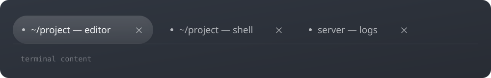

# Ghostty Superlogical Tabs

An unofficial GTK tab style for [Ghostty](https://ghostty.org/) inspired by Superlogical: compact content-width tabs, a fully rounded active pill, subtle glass shading, and terminal-matched window chrome.



## Requirements

- Linux Ghostty using the GTK runtime
- Ghostty 1.2 or newer (tested with 1.3.1)

## Install

Clone the repository inside your Ghostty configuration directory:

```sh
git clone https://github.com/al3rez/ghostty-superlogical-tabs.git \
  ~/.config/ghostty/superlogical-tabs
```

Then add this line to `~/.config/ghostty/config`:

```ini
config-file = superlogical-tabs/superlogical-tabs.conf
```

Fully restart Ghostty if the window decoration does not update immediately.

## Uninstall

Remove the `config-file` line from your Ghostty config, then delete the cloned directory:

```sh
rm -rf ~/.config/ghostty/superlogical-tabs
```

## What it changes

- Removes the separate GTK titlebar while retaining a top tab strip
- Keeps tabs content-width instead of stretching them across the window
- Uses 28px pill corners and 10px spacing
- Gives the active tab a subtle translucent gradient and inset shadow
- Makes the tab-strip background follow the terminal background

Edit [`tabs.css`](tabs.css) to adjust tab width, radius, spacing, or shading.

## Attribution

This is an independent, unofficial theme and is not affiliated with Ghostty or Superlogical. Its visual direction was inspired by [Superlogical](https://www.superlogical.com/) and the MIT-licensed [`stylessh/superlogical-web`](https://trylle.com/stylessh/superlogical-web) project.

## License

[MIT](LICENSE)
